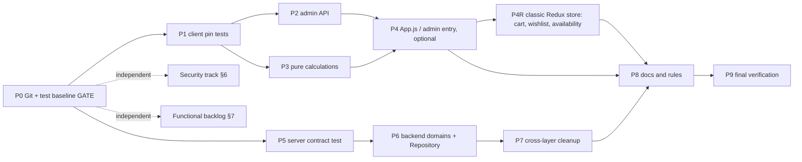

# Technic Tambur — Refactor Plan (revision 2)

**Status: proposal, waiting for the owner's approval. No application code, dependency, schema or configuration was changed, and no test was run for this revision.** The only files created in this whole planning effort are `ARCHITECTURE_AUDIT.md`, `TARGET_ARCHITECTURE.md` and this file. The last recorded test baseline (`.doc/test-baseline.md`: 671 passed, 0 failed) dates from 2026-10-10 at commit `af37de1` and **predates the staged order-lookup work**; it must be re-measured in P0.

Written for: the project owner. Read [`TARGET_ARCHITECTURE.md`](TARGET_ARCHITECTURE.md) first (tree, responsibilities, dependency audit, security matrix).

**What changed in revision 2**

| Area | Change |
|---|---|
| Scope | Much smaller client reorganisation; all cosmetic renames removed (see `TARGET_ARCHITECTURE.md` §2). Old P11 (folder rename, `.jsx`) **deleted**: you decided to keep `client/`, `server/` and `.js`. |
| Admin 401 | `createAdminApi(onUnauthorized)` instead of `setUnauthorizedHandler` (P2). |
| Tests | Black-box and fetch-level behavior tests; no walking of Express internals. Every phase lists behavior to preserve, baseline tests, verification tests and manual checks (§3, §5). |
| Security | A **separate security track** with priorities and a "before public launch" list (§6). |
| Git | P0 is now an **explicit gate**: nothing starts until you decide the Git baseline and branch (§5, P0). |
| Phases | Renumbered: client P1–P4, server P5–P7, docs P8, final verification P9. |
| Shared state (added after P4) | **Classic Redux** (`redux`, `react-redux`, `redux-thunk`; no Redux Toolkit, no `createSlice`, no TypeScript) replaces the Context for the cart, the wishlist and the product availability: new phase **P4R** (details: `.plan/001-2026-11-13-redux-store.md`). The admin hooks and the admin session stay outside Redux; the checkout form and the menu state stay React state in `StoreLayout`. |

---

## 1. Principles for every phase

1. **Behavior does not change.** A structural phase never fixes a bug, adds a check or changes an API response, status code, message or cookie. Bug fixes and security fixes are in §6 and §7, on their own branches.
2. **Pin first.** If code is about to move or be extracted and no test covers its externally visible behavior, the test is its own commit, before the change.
3. **Test behavior, not structure.** Server tests call the running HTTP API (method, path, cookie → status, body, headers). Client tests drive a component or a hook's public result with a fake `fetch` and assert what is rendered and which request was sent. No test inspects Express's router stack, private hook state or call order inside a module.
4. **One small change per step**; one phase = one branch = one pull request; moves (`git mv`) are separate commits from content edits so `git log --follow` works.
5. **I never run `git commit`, `merge`, `push` or `tag`**, and I will not `stash`, `reset`, `checkout` over, or otherwise touch your staged work. I stage my own changes only when you tell me to, propose the commit message, and stop. I never run `--target cloud` commands, never touch the schema, never read env files.
6. **No new library** (see `TARGET_ARCHITECTURE.md` §1.2, §11, §12), no schema change, no deployment, no external-service change, in any phase. **One approved exception:** `redux`, `react-redux` and `redux-thunk` in phase P4R (decision D11), and nothing else.
7. **Approval gate between phases:** after each phase I report what changed and which checks I ran (with their real output), and wait for "go".
8. **I report only tests I actually ran.** If I cannot run something (for example no `TEST_DATABASE_URL`), I say so and ask you to run it.

---

## 2. Verification of `ARCHITECTURE_AUDIT.md` (kept from revision 1)

Every item below was re-read in the source. **One audit finding was wrong (A-19)**, and the audit file is still unchanged because you asked for planning files only.

| Brief item | Audit | Result | Evidence |
|---|---|---|---|
| Repeated HTTP in admin hooks | A-15 | Confirmed | `useAdminOrders` (status, picked, delete, load), `useAdminProducts` (create, update, delete, patch, upload, import), `useAdminReviews`, `useStatsBaseline` each repeat `api(url,{method,headers,body})` + `res.ok` + `errorMessageFrom` + `catch → NETWORK_ERROR`. |
| Large hooks | §3.10 | Confirmed | statistics and CSV in `useAdminOrders.js:174-256`; CSV parser in `useAdminProducts.js:39-67`; maths in `PaintCalculator.js`. |
| Duplicate statistics | A-06 | Confirmed | client `useAdminOrders.getStats` vs server `order.service.getStats`/`order.controller.stats` (no client caller). |
| Duplicated delivery config | A-07 | Confirmed | fee `useCart.js:12` vs `env.js`; cities `CheckoutFormView.js:22` vs `order.validator.js:48`; statuses in 4 code places + DB `CHECK`. |
| Service imports validator | A-05 | Confirmed | `order.service.js:12-15`. |
| Image processing in middleware | A-11 | Confirmed | `middleware/upload.js processUploads`; `errorHandler.js:6` imports from it. |
| Server reads client source | A-02 | Confirmed | `server/utils/categories.js` (`new Function`). `categories.js` has two exports (`SUBCATEGORY_NAMES`, default), so it is *almost* pure data. |
| Duplicate product filter SQL | A-08 | Confirmed | `product.model.js` `list` / `count`. |
| CSV inconsistencies | A-16 | Confirmed | UI import: naive splitter, 7 columns, one `POST` per row, no SKU de-duplication; CLI import merges and contains raw SQL. |
| Cart variant identity | A-13 | Confirmed by reading; **no failing test yet** | `useCart.addToCart` `same()` ignores `selectedVariant` (lines 42-44), while `ProductDetails.js:173-174` passes it. |
| Public rate limiting | A-01 | Confirmed | no limiter on `order.routes.js:29`, `review.routes.js:14`. |
| Stock at checkout | A-03 | Confirmed, with nuance | API accepts out-of-stock items (`findPricesByIds` omits `in_stock`); the UI disables "הוסף לעגלה" (`ProductBuyRow.js`). |
| Hard-coded IDs | A-14 | Confirmed | `PaintCalculator.js:33-37` (627, 628, 416). |

**Corrections:** (1) **A-19 is wrong about `Product.remove` and `Order.countByProductId`** — they are called by `scripts/products-import-new.js:372,388`; keep them. (2) A-03 nuance above. (3) A-13: variant path confirmed in `ProductDetails.js`.

**Security items re-verified for this revision** (details in `TARGET_ARCHITECTURE.md` §12): all dynamic SQL identifiers in all five models are whitelisted by the validators (`SORTABLE` in order, product, review and pigment validators; `EDITABLE`/`WRITABLE` for columns); no dangerous DOM API in `client/src`; emails escape customer fields; cookie flags and expiry as described; `NODE_ENV` controls six protections.

---

## 3. Test strategy

### 3.1 What exists (by file list; none executed for this revision)

- **Server (27 files in `test/`):** `unit-*` need no database; `smoke-*` start a real server on port 3100 against `TEST_DATABASE_URL` and call the HTTP API. These are already behavior tests. Run: `npm test`.
- **Client (13 Jest files):** `useCart`, `useAdminOrders` (pick list only), `pricing`, `pickList`, `productService`, `storeServices`, `Drawer`, `OrderHistory`, `CategoryPage`, `ProductDetails`, `ProductReviewsSection`, `OrderCard`, `ProductsTab`. Run: `npm run test:client`.
- **Build and accessibility:** `npm run build:client` (a bad import fails the build), `npm run a11y` (needs the build).

### 3.2 Gaps to close — as pin-only commits, before the code they protect changes

| Behavior (externally observable) | Test | Level | Before phase |
|---|---|---|---|
| Admin requests: URL, method, headers, body, and the user-facing error text for each admin action (status change, pick toggle, delete order, create/update/patch/delete product, upload, approve/delete review, stats baseline) | Fake `fetch` returns canned responses; drive via the hook's returned functions or the tab; assert the recorded request and the rendered message | client | P2 |
| **401 handling:** an admin call that returns 401 → the session-expired callback is called **and** the same message as today is shown; a wrong password at login is **not** treated as expiry | same | client | P2 |
| **List responses that are not OK:** orders → empty list; reviews → empty list; products → list unchanged | same | client | P2 |
| Statistics numbers (today / week / month / revenue / top categories / last-7-days / out of stock / `since` filter) | Fixed orders and a fixed clock (`jest.useFakeTimers().setSystemTime`) → expected numbers, observed through `StatsTab` rendering or the hook's returned `getStats` | client | P3 |
| CSV export text | Capture the `Blob` passed to `URL.createObjectURL`; assert BOM, header row, quoting, Hebrew labels | client | P3 |
| CSV import parsing | File with valid rows, bad price, bad category, quoted commas → previewed rows / error messages; confirm the `POST` bodies | client | P3 |
| Paint calculator results | Fixed walls/windows/doors/coats/shade → liters and pigment shown | client | P3 |
| Checkout: 201 clears cart and shows success; 409 applies `details.prices` and keeps the cart; network error keeps the cart | fake `fetch` | client | P3/P4 (pin in P1) |
| Cart merge (current behavior, including the variant gap) | `useCart` test documenting today's result, marked as such so BF-01 can change it deliberately | client | P1 |
| **HTTP contract of every endpoint** | New black-box `test/smoke-contract.js` (see P5) | server | P5 |
| Cookie flags under `NODE_ENV=production` (`Secure`) | child-process unit test in the style of `unit-config.js` | server | security track |

### 3.3 Per-commit and per-phase checks

Per commit: `npm test` (server phases) or `npm run test:client` (client phases). Per phase: both, plus `npm run build:client`, plus the phase's manual checks. End of project (P9): all of that plus `npm run a11y` and the manual walk-through. If `TEST_DATABASE_URL` is not configured in the environment I cannot run the server suites; in that case you run them and give me the output.

---

## 4. Findings, separated

### A. Architecture and maintainability (no behavior change) — inside the phases

| ID | Item | Phase |
|---|---|---|
| ARC-01 | Admin HTTP duplication → `adminService.createAdminApi` (A-15) | P2 |
| ARC-02 | Statistics, CSV and paint maths out of hooks/components (§3.10) | P3 |
| ARC-03 | One client file for delivery fee and cities, `utils/delivery.js` (A-07, client side only) | P3 |
| ARC-04 | `App.js` → routes only; admin entry files with the admin screens (optional) | P4 |
| ARC-05 | Backend domain folders; Model → Repository | P6 |
| ARC-06 | `order.rules.js`: service stops importing from the validator (A-05) | P7 |
| ARC-07 | Image processing out of middleware; constants out of `upload.js` (A-11) | P7 |
| ARC-08 | `categories.json` instead of `new Function` (A-02) | P7 |
| ARC-09 | One `buildFilters()` in the product repository (A-08) | P7 |
| ARC-10 | Shared validator helpers (A-10) | P7, optional |
| ARC-11 | Repositories verify column names (A-09, also security hardening) | P7, optional |
| ARC-12 | One constant for the store address in email templates (audit F04) | P7, optional |

### B. Functional bugs and product decisions — separate backlog (§7)

BF-01 cart variant merge · BF-02 out-of-stock orders · BF-03 hard-coded paint-calculator IDs · BF-04 CSV import inconsistencies · BF-05 update/status race returns 500 · BF-06 delivery fee not compared by the server.

### C. Security — separate track (§6)

SEC-01 … SEC-14, with a **"before public launch"** list.

### D. Future improvements

FUT-01 admin order list pagination / polling load · FUT-02 one source of truth for statistics (use `GET /orders/stats` or delete it) · FUT-03 `ProductFormTab` fields as one object · FUT-04 move raw SQL from `scripts/import-products.js` into the repository · FUT-05 serve categories and delivery config from the API · FUT-06 indexes (only when measured) · FUT-07 drop/use `products.stock`, unused `SITE_MODE` · FUT-08 structured logging · FUT-09 replace Create React App (separate decision).

---

## 5. Phases

### Dependencies

The client track (P1–P4, then P4R) and the server track (P5–P7) are independent after P0. I recommend **starting with the server contract test (P5) and the security track item SEC-01**, because they are small and protect everything that follows (§9).

---

### P0 — Git baseline and test baseline (GATE)

**You decide, then nothing else starts.** Facts at the start of this conversation [V from the session's git status, to be re-checked with read-only `git status`]: current branch `feat/cloud-deploy`; **23 files staged and not committed** (order-lookup work: client `OrderHistory`, `orderService`, `OrderSuccessView`, server order controller/model/routes/service/validator/email template, tests, docs); untracked: `ARCHITECTURE_AUDIT.md`, `TARGET_ARCHITECTURE.md`, `REFACTOR_PLAN.md`. I will not stash, commit, reset, checkout over or otherwise alter any of it.

Decisions needed:

1. **What happens to the staged work?** (You commit it yourself, on `feat/cloud-deploy`.)
2. **Where do refactor branches start?**
   - **A (recommended):** after `feat/cloud-deploy` is merged to `main`, branch each phase from `main`. Cleanest history; no conflicts with the cloud work.
   - **B:** branch each phase from the tip of `feat/cloud-deploy` after step 1. Faster, but the refactor will conflict with later cloud-deploy commits that touch the same files (order, storage, env).
   - **C:** a separate `git worktree` directory on a new branch, leaving your current checkout and staged work untouched. Needs its own `node_modules` and a copy of your local env file (made by you; I never read it).
3. **Branch names.** `.claude/rules/git-workflow.md` allows only `feat/`, `fix/`, `chore/`, `docs/`. Either use `chore/<topic>` (e.g. `chore/admin-api`, `chore/server-domains`) or approve adding `refactor/` to the rule (P8 would update it). Security fixes use `fix/<topic>`.
4. **Who runs the server tests?** Is `TEST_DATABASE_URL` configured so I can run `npm test`?

Then (after the gate): create the first branch; run `npm test`, `npm run test:client`, `npm run build:client`, `npm run a11y`; record counts, date and commit in `.doc/test-baseline.md`; the list of endpoints from `docs/ARCHITECTURE.md` and `test/smoke-*` is the reference for P5.

- **Behavior to preserve:** everything (nothing changes).
- **Acceptance:** decisions written down; baseline numbers recorded from real runs; clean branch.
- **Rollback:** delete the new branch.

---

### P1 — Pin client behavior that will change hands (tests only)

- **Goal:** observable-behavior tests so P2–P3 are provably neutral.
- **Files:** new tests only — extend `hooks/useAdminOrders.test.js`; new `hooks/useAdminProducts.test.js`, `hooks/useAdminReviews.test.js`, `hooks/useCheckoutForm.test.js`, `features/calculators/PaintCalculator.test.js`; one added case in `hooks/useCart.test.js` documenting today's merge behavior.
- **Baseline tests:** the rows of §3.2 marked P2/P3/P1 — fake `fetch`, assertions on recorded requests and rendered text.
- **Behavior to preserve:** all of it; no production file is touched.
- **Dependencies:** P0.
- **Risks:** tests coupled to internals → keep to "input → rendered output / recorded request".
- **Verification:** `npm run test:client` green; tests also pass against an intentionally changed copy only mentally — not required.
- **Acceptance:** each row of §3.2 for P1–P3 has at least one test; one commit per test file.
- **Rollback:** revert the test commits.

---

### P2 — Admin API layer (ARC-01)

- **Goal:** admin requests are written once, in a service, with today's exact behavior.
- **Files affected:** `services/http.js` (add `putJson`, `deleteJson`, `postForm`), `hooks/useAdminOrders.js`, `hooks/useAdminProducts.js`, `hooks/useAdminReviews.js`, `hooks/useStatsBaseline.js`, `pages/admin/Admin.js`, `pages/admin/StatsTab.js` (it passes `api` to `useStatsBaseline`), `pages/admin/ImportTab.js` (to be checked), `utils/apiErrors.js` (stays; unused exports removed only if truly unused).
- **Destination:** new `services/adminService.js` exporting `createAdminApi(onUnauthorized)` (design and 7 behavior rules in `TARGET_ARCHITECTURE.md` §4.2).
- **Changes:** (1) `createAdminApi` functions call `http.js`; on 401 they call `onUnauthorized()` and still surface the same error. (2) `Admin.js` creates it once with `useMemo` and passes it to the hooks instead of `api`. (3) Each hook replaces raw `fetch` with the matching call and keeps its state, optimistic logic and messages. (4) `authService` is untouched.
- **Behavior to preserve:** the 7 rules in §4.2 of the target document — in particular: 401 → expire callback then same message; login errors are not expiry; non-OK lists → orders `[]`, reviews `[]`, products unchanged; identical URLs/methods/headers/bodies; identical Hebrew fallbacks; `FormData` upload without manual `Content-Type`.
- **Baseline tests:** P1 tests (written against the old code, must pass before the change).
- **Verification tests:** the same P1 tests, unchanged, pass after; plus a unit test of `createAdminApi` with a fake fetch (401 calls the callback; non-401 error does not).
- **Manual checks:** log in, open every admin tab; delete the cookie (browser dev tools) and click an action → returns to login; wrong password shows the same message; create product with an image; change order status; tick pick-list lines.
- **Dependencies:** P1. **Risks:** the 401 order of events; the three different "not OK" behaviors; one-character differences in bodies/headers.
- **Acceptance:** `grep -rn "fetch(" client/src/js` finds only `services/*` (and none in `hooks/`, `pages/`, `components/`, `features/`); all tests and the build green; no changed user-facing text.
- **Rollback:** revert the phase (client-only).

---

### P3 — Pure calculations out of hooks and components (ARC-02, ARC-03)

- **Goal:** statistics, CSV and paint maths are plain functions you can read and test.
- **Files → destination:**
  - `hooks/useAdminOrders.js` (`getStats`, CSV text of `exportOrdersToExcel`) → new `utils/orderReports.js` (`computeOrderStats`, `ordersToCsv`); the hook keeps the download (Blob, anchor).
  - `hooks/useAdminProducts.js` (`parseCSV`, template text) → new `utils/productCsv.js`.
  - `features/calculators/PaintCalculator.js` (`blendWithWhite`, `isLight`, area/liters/pigment maths in `calculate()`) → new `utils/paintCalc.js`.
  - `hooks/useCart.js` (`DELIVERY_FEE`) and `features/cart/CheckoutFormView.js` (`ALLOWED_CITIES`, `checkAllowedCity`) → new `utils/delivery.js`.
  - `pages/admin/StatsTab.js`: calls the util directly if that removes the `getStats` prop.
- **Changes:** function bodies are cut and pasted unchanged; each original file imports from the util; one small unit test per util reusing the P1 fixtures. **No formula, rounding or boundary is edited.**
- **Behavior to preserve:** every number, every CSV character, every paint result.
- **Baseline tests:** P1 (unchanged, still through the hooks/components). **Verification:** the same, plus the util tests.
- **Manual checks:** Stats tab (with and without "reset" baseline), export CSV and open in Excel (Hebrew intact), import a CSV, paint calculator with two walls and a shade.
- **Dependencies:** P1. **Risks:** accidental change of date boundaries (functions read the clock) — keep bodies identical.
- **Acceptance:** moved bodies are identical (reviewed in the diff); `useAdminOrders.js` and `PaintCalculator.js` contain no calculation; all tests green.
- **Rollback:** revert per file.

---

### P4 — `App.js` and the admin entry (ARC-04, **optional**; each item can be skipped)

- **Items:** (a) new `context/StoreProvider.js` holding the hook composition from `App.js` (same `useMemo` object, same shape); `App.js` keeps routes. (b) move `pages/AdminLogin.js` and `routes/AdminRoute.js` into `pages/admin/` and fix the three imports (`App.js`, `AdminRoute.js`, tests).
- **Benefit:** `App.js` becomes a readable route table; the admin entry sits next to the admin screens. **Nothing else moves.**
- **Behavior to preserve:** the context value shape; cart persistence across navigation; lazy admin chunk.
- **Tests:** P1 tests + `npm run build:client` (a wrong path fails the build); `smoke-static` guards that admin code stays out of the main bundle.
- **Manual:** cart survives category → product → cart modal → checkout; `/admin` redirects and logs in.
- **Dependencies:** P2, P3. **Risk:** re-render behavior if the `useMemo` dependency list changes — move it verbatim. **Rollback:** revert.
- **Outcome (done):** both items were **skipped**: `App.js` was already a readable route table with a 35-line composition block, and moving `AdminRoute`/`AdminLogin` would only churn three documents. A test file `App.test.js` pinning the admin entry (redirect, lazy chunk, session guard) was added instead. `StoreProvider.js` is superseded by P4R.

---

### P4R — Classic Redux store for the shared storefront state (added after P4; decision D11)

- **Goal:** the cart, the wishlist and the product availability live in one classic Redux store (`redux`, `react-redux`, `redux-thunk`; plain actions, separate actions and reducer files, `combineReducers`, selectors, two thunks). No Redux Toolkit, no `createSlice`, no TypeScript. Replaces the Context composed in `App.js`.
- **Plan file (state shape, action catalog, folder structure, steps, acceptance criteria, risks):** `.plan/001-2026-11-13-redux-store.md`.
- **Files affected:** new `client/src/js/store/` (12 files + tests); `App.js` (Provider), `StoreLayout.js` (checkout form hook and `menuOpen` state), `Navbar` (props), `hooks/useCheckoutForm.js` (reads the cart via selectors), the cart/catalog components that call `useStore()`; deleted at the end: `context/storeContext.js`, `useCart.js`, `useWishlist.js` (`useAvailability.js` stays: `RelatedProducts` also uses it for the recently viewed list, which is local state, not shared). `client/package.json` and lockfile gain the three packages.
- **Stays outside Redux:** admin hooks and the admin session; checkout form fields and submit logic (local to `StoreLayout`, because they must outlive `CartModal`); `menuOpen`; the second wishlist path (`wishlistUtils`).
- **Behavior to preserve:** every cart rule (merge by id/color/size for `addItem`, by id for bundles — BF-01 stays), the agorot arithmetic, the delivery fee, `localStorage` persistence (`tamburia-cart`, `tamburia-wishlist`, including the initial write on startup), the checkout outcomes (201, 409 re-pricing, rejections, connection failure), the availability request and its failure-tolerance, the lazy admin chunk. Known bugs stay.
- **Baseline tests:** new pin tests first (step 3 of the plan: persistence, wishlist toggle, availability, checkout fields surviving the drawer, context key set), plus the existing P1–P4 tests unchanged in their assertions.
- **Verification:** reducer and selector unit tests; the P1 `useCart*`/`useCheckoutForm` assertions on the new code; render-count guard; `npm run test:client`, `npm run build:client`, bundle check that admin strings stay in the lazy chunk.
- **Manual:** cart survives category → product → cart → checkout and a refresh; wishlist hearts; hidden product flagged in a saved cart; order success empties the cart; 409 re-prices; typed checkout fields survive closing and reopening the drawer.
- **Dependencies:** P4 (branch from the approved P4 commit; P1–P4 are not yet merged into `main`). **Risks:** cart persistence (initial write), re-renders from broad selectors, Jest 27 with the packages' CommonJS builds (gate after install), stacked pull requests. **Rollback:** each step is a commit; the whole phase is dropped by removing `store/` and the Provider until the last deletion step.

---

### P5 — Black-box HTTP contract test (tests only)

- **Goal:** prove no endpoint, status code, guard or error shape changes in P6/P7, **without touching Express internals**.
- **Files:** new `test/smoke-contract.js` (added to `test/run-all.js`).
- **Design:** a table of `(method, path, body)` for **every** endpoint listed in `docs/ARCHITECTURE.md` and the route files, checked over HTTP against the test server:
  - without a cookie, every admin route → **401**;
  - with an admin cookie, a **side-effect-free probe** → expected 4xx that proves the route exists and is the right one (e.g. `PUT /api/orders/0/status` → 400 "מזהה לא תקין"; `POST /api/products` with `{}` → 400 "חסר שם מוצר"; `GET /api/products/2147483647` → 404 with a message that is **not** the router's generic "הנתיב לא נמצא");
  - public routes return their documented status (`GET /api/products` 200, `POST /api/orders` with `{}` 400, …);
  - `GET /api/unknown` → 404 `{error:'הנתיב לא נמצא'}`;
  - response headers `Cache-Control` for `/uploads`, `/static`, `index.html` as in `smoke-static`.
  It covers the five admin routes `smoke-auth.js` does not (`GET/PUT /orders/:id`, `PUT /orders/:id/items/:line/picked`, `GET/PUT /reviews/:id`), so it doubles as **SEC-04**.
- **Behavior to preserve:** all (test only). **Baseline:** passes on the current code. **Verification:** passes after P6 and P7 unchanged.
- **Manual:** none. **Dependencies:** P0. **Risks:** a probe accidentally writes data — probes use invalid ids/empty bodies by design; review each one.
- **Acceptance:** green on current code; ≥ every endpoint in the reference list is covered.
- **Rollback:** revert.

---

### P6 — Backend domain folders and Model → Repository (ARC-05)

- **Goal:** `server/api/<domain>/` per `TARGET_ARCHITECTURE.md` §2 and §7.1.
- **Precondition commit:** add **Repository** to `.doc/glossary.md`.
- **Order (one domain per commit: `git mv` + import fixes + variable rename `Order` → `orderRepository` + test/script path updates; no content change):**
  1. `setting` · 2. `pigmentFormula` · 3. `review` · 4. `auth` (no repository; imported by `middleware/requireAdmin.js` and `services/realtime.service.js`) · 5. `upload` (middleware stays) · 6. `product` · 7. `order` + `pricing.service.js` · 8. `routes/index.js` → `api/index.js`; `app.js` import.
- **Other files whose `require` changes:** `scripts/images-products.js`, `products-hide-unphotographed.js`, `products-import-new.js` (uses `Product.remove` and `Order.countByProductId` — keep them), `products-list.js`; tests that stub modules by absolute path: `unit-order-service.js`, `unit-product-service.js`, `unit-review-service.js`, `unit-images-from-uploads.js`, `unit-image-url.js`, `unit-order-lookup.js`.
- **Behavior to preserve:** every route path and mount order (`/stats` before `/:id`, `/categories` before `/:id`, `/code/:code`, `/all`), SQL text, error shapes.
- **Baseline tests:** P5 contract test + full server suite on the pre-move code. **Verification:** the same, unchanged, after each domain commit.
- **Manual:** `npm start`; storefront browse, add to cart, checkout (pickup), admin login, edit a product, upload an image.
- **Dependencies:** P5. **Risks:** (1) router order inside moved route files; (2) tests that stub by absolute path — they are *tests of services* and are updated with the move; (3) `scripts/` are not run by `npm test`, so after each commit I grep `require('../server/` and load only scripts that are safe to load (never one that writes on import or uses `--target cloud`).
- **Acceptance:** P5 and all suites green after every commit; no `*.model.js` file remains; `grep -rn "models/" server scripts test` is empty; `git log --follow server/api/order/order.repository.js` shows the model's history.
- **Rollback:** each domain commit is independently revertable.

---

### P7 — Cross-layer cleanup (ARC-06 … ARC-12), one commit per step

| Step | Change | Files | Behavior preserved (how it is checked) |
|---|---|---|---|
| P7.1 | `order.rules.js`: delivery-area and status↔method constants and functions move out of the validator; validator and service import it | `api/order/*` | same messages and codes (`smoke-orders`, `unit-order-service`, `unit-order-lookup`, contract test) |
| P7.2 | Image processing out of the middleware: loop → `image.service.saveUploadedImages`; `MAX_FILE_SIZE` → `utils`/`config`; `errorHandler` stops importing `upload.js` | `middleware/upload.js`, `errorHandler.js`, `image.service.js`, `api/upload/*` | same files saved under the same hash names; same multer error JSON (`unit-upload-flow`, `smoke-products`; manual upload of one photo, local storage) |
| P7.3 | `categories.json`: `categories.js` imports it; `server/utils/categories.js` `require`s it (no `fs`, no `new Function`) | `client/.../categories.js`, new `.json`, `server/utils/categories.js`, `scripts/lib/categories.js` re-export | same subcategory rules (`unit-product-service`, `smoke-products`, `smoke-fresh-db`; client `CategoryPage.test.js`, build) |
| P7.4 | `buildFilters()` shared by product `list` and `count` | `product.repository.js` | add a test that `pagination.total` equals the filtered list for each filter, then refactor |
| P7.5 *(optional)* | shared `asTrimmedString` / paging helpers, only if ≥ 3 validators benefit | validators | smoke suites |
| P7.6 *(optional)* | repositories reject column names not in their own list (also **SEC-12**) | order, product, review, pigment repositories | valid callers unaffected (smoke suites); add a test that an unknown key throws |
| P7.7 *(optional)* | one constant for the store address in email templates | `services/email/templates/*` | `smoke-orders`; look at one rendered email |

- **Dependencies:** P6. **Risks:** P7.1 message strings; P7.2 multer error mapping; P7.3 JSON import under CRA/Jest (both support it).
- **Acceptance:** `order.service.js` requires no validator; `middleware/` contains no image/storage call; `grep -rn "new Function" server` is empty; one filter builder in the product repository.
- **Rollback:** each step reverts independently.

---

### P8 — Documentation and rules

- **Files:** `.doc/glossary.md` (Repository, already added in P6), `.doc/architecture.md`, `.doc/codebase-map.md`, `docs/ARCHITECTURE.md` (folder structure, request flow, test list), `README.md`, `AGENTS.md` (Repository Layout), `.claude/rules/naming.md` (domain folders, `*.repository.js`), `.claude/rules/git-workflow.md` (only if you approve `refactor/` branches), `.claude/skills/*/SKILL.md` and `.github/copilot-instructions.md` / `.cursor/rules/index.mdc` where they mention `models/`, and the A-19 correction in `ARCHITECTURE_AUDIT.md`.
- **Checks:** `grep -rn "models/\|\.model\.js" *.md docs .doc .claude`; `unit-repo-hygiene`.
- **Redux (P4R) and P8:** the architecture text, the glossary terms (store, action, reducer, selector, thunk) and the `TARGET_ARCHITECTURE.md` changes for Redux are written **in P4R**, before and during the migration. P8 only reconciles them with the final file list: `docs/ARCHITECTURE.md` and `.doc/codebase-map.md` must no longer mention `context/storeContext.js`, `useCart`, `useWishlist` or `useAvailability`.
- **Acceptance:** no document names a path that no longer exists. **Rollback:** revert.

---

### P9 — Final verification

1. `npm test`, `npm run test:client`, `npm run build:client`, `npm run a11y` — counts compared with the P0 baseline (may increase, must not decrease).
2. The contract test (P5) green; `git log --follow` works on three moved files.
3. Manual walk-through (written down): browse a category; open a product with variants; add to cart and refresh (cart persists); guest checkout, pickup and delivery; price-change 409 (if reproducible); order lookup by number + phone; admin login, logout, expired session; create a product with two images; edit; hide/show; change an order status; pick-list ticks; Stats tab; CSV export and import; reviews moderation; paint calculator; pigment list; live new-order chime; both storage drivers (Cloudinary only with your approval and a `--target cloud` run by you).
4. `npm start` against the build with `SERVE_CLIENT` on and off.
5. P4R: the store tests (reducers, selectors, persistence, thunks) and the render-count guard are part of the client suite; the admin API strings are only in the lazy chunk of the build.
- **Acceptance:** every item ticked; any difference recorded and explained. **Rollback:** revert the PR that introduced a regression.

---

## 6. Security track (independent of the refactor; each item its own `fix/` branch)

Rules: **never mixed into a structural phase**; each item has its own failing test first where possible; no new library; behavior changes need your approval. Priorities: **Before launch** = resolve before the app is publicly reachable.

| ID | Priority | Task | Files | Test / check | Acceptance |
|---|---|---|---|---|---|
| **SEC-01** | **Before launch** | Rate-limit `POST /api/orders` and `POST /api/reviews` with the existing `rateLimit()`. Limits are **env-configurable** (new variables documented in `.env.example`) so `test/run-all.js` can raise them — otherwise the suites, which create many orders from one IP, would hit the limit. Proposed defaults for you to confirm: orders 10 per 15 min, reviews 5 per 15 min per IP. | `order.routes.js`, `review.routes.js`, `config/env.js`, `.env.example`, `test/run-all.js` | Black-box: N+1 requests in the window → 429 with `Retry-After` and the Hebrew message; normal use unaffected | 429 on excess; all existing suites green |
| **SEC-02** | **Before launch** | Production-environment checklist **(runtime)**: `NODE_ENV=production` set at the host (start log shows `(production)`); cookie carries `Secure` and login persists over HTTPS; HSTS header present; CORS closed; `req.ip` is the visitor's (rate-limit counters per visitor, `trust proxy = 1` matches the host's single proxy). Add a child-process unit test that `cookieOptions().secure` is true under `NODE_ENV=production`. | `test/unit-*.js` (new), deployment notes | Manual on the real host; unit test | Checklist ticked with evidence |
| **SEC-03** | **Before launch** (recommended) | Content Security Policy: start the app with `CSP_ENABLED=true`, open every page and the admin in a browser, read the console; fix only what is truly blocked; then enable by default in production. The existing comment about JSON-LD should be re-tested, as the local build has no inline executable script. | `securityHeaders.js`, `config/env.js` | Browser console clean on all pages (**runtime**) | No violations; header present in production |
| **SEC-04** | **Before launch** | Auth coverage test for **every** admin route (the five missing today) | `test/smoke-contract.js` (P5) | Black-box | All admin routes 401 without cookie |
| **SEC-05** | **Before launch** (owner) | Run `npm audit` for production dependencies (needs the registry; I have not run it) and review results; no automatic upgrades | `package.json` | Owner/approved run | Findings triaged in writing |
| **SEC-06** | **Before launch** (owner) | Confirm the tracked `client/.env.development` contains no secret (the guardrail hook blocked me from reading it; `REACT_APP_*` values are public in the bundle) | `client/.env.development` | Owner check | Confirmed |
| **SEC-07** | **Before launch** (decision) | Order lookup is open to anyone who knows number + phone (audit B03). Decide: accept, or one-time code. | `order.routes.js`, `order.service.js` | — | Decision recorded |
| **SEC-08** | Soon | `MAIL_ENABLED` unset currently means **on** (audit B04); decide the default. Mask customer email addresses in log lines (`transporter.js:26,32,35`). | `config/env.js`, `transporter.js` | `unit-config` | Decision + test |
| **SEC-09** | Soon | **Session revocation.** Options: (a) rotate `SESSION_SECRET` (no code; logs everyone out); (b) a "valid after" timestamp in the existing `settings` table (one new key, no schema change; logout sets it, `verifyToken` rejects older tokens). Not `express-session`. Needs your approval of the approach. | `auth.service.js`, `auth.controller.js`, `setting.validator.js` | Black-box: token issued before logout is rejected after | Old token → 401 |
| **SEC-10** | Soon (optional) | Origin/Host check for state-changing requests and the WebSocket upgrade (a few lines, no library). | new middleware, `realtime.service.js` | Black-box: cross-origin `Origin` → 403, same-origin unaffected | As stated |
| **SEC-11** | Soon | Remove the stack trace from non-production 5xx (audit B02) | `errorHandler.js` | `smoke-*` | No `stack` in any response |
| **SEC-12** | Soon | Repositories check column names against their own list (= P7.6) | repositories | unit test | Unknown key throws |
| **SEC-13** | Later | Hygiene tests: no `dangerouslySetInnerHTML`/`eval` in `client/src`; each email template with `<script>` in every customer field renders escaped; try a very large image (**runtime**); decide the session length (default 12 h) | `test/` | as stated | Tests green |
| **SEC-14** | Later | Shared rate-limit store only if more than one server instance will run | `rateLimit.js` | — | — |
| *(decision)* | — | **Password hashing (bcrypt/argon2), Cryptr, express-session, Zod, helmet, CSRF package: not recommended now** (reasons in `TARGET_ARCHITECTURE.md` §12). `SameSite` stays **Strict**. | — | — | Confirm |

### Security issues to resolve before public production deployment

1. SEC-01 public write rate limits.
2. SEC-02 production flag, `Secure` cookie, HSTS, proxy IP (runtime).
3. SEC-03 Content Security Policy (recommended).
4. SEC-04 admin-route test coverage.
5. SEC-05 `npm audit` review.
6. SEC-06 tracked client env file.
7. SEC-07 and SEC-08 decisions (order lookup, mail default).

Static inspection does **not** show the application is secure; rows marked runtime in the matrix must be checked on the real host.

---

## 7. Functional backlog (separate from the refactor; each needs a failing test first and your approval)

| ID | Task | Test first | Notes |
|---|---|---|---|
| **BF-01** | **Cart variant merging:** `useCart.addToCart` ignores `selectedVariant`; `addBundleToCart` matches by `id` only | Add two different variants of one product with no colour/size → expect two lines with their own price; currently fails | Small, user-visible. Candidate to do **early** (before P2/P3 touch neighbouring code) |
| **BF-02** | **Out-of-stock orders:** API accepts items with `in_stock = false` | `POST /api/orders` with such a product → expect the agreed status | Product decision (reject, or keep phone confirmation); the UI already disables the button |
| **BF-03** | **Hard-coded paint-calculator IDs** (627, 628, 416) | Calculator with a missing product → defined behavior | Look up by `sku` or a setting; agree the fallback |
| **BF-04** | **CSV import inconsistencies:** UI import duplicates on re-import and ignores variants/subcategory | Import the same file twice → no duplicates | Remove the UI tab, or call a server endpoint that reuses `product.validator` and the merge rules |
| **BF-05** | Update/status race returns 500 instead of 404 when the order is deleted mid-request | Simulated via a stubbed repository returning `null` | One-line fix like `setItemPicked` |
| **BF-06** | Delivery fee is not compared by the server | Change `DELIVERY_FEE` server-side only → expect 409 (or the agreed behavior) | Needs an API addition or a rule change |

---

## 8. Commit and branch plan

- One branch per phase/security item; names per P0 decision (default `chore/<topic>` for refactor, `fix/<topic>` for security and bugs).
- Commit subjects `type(scope): summary` (`test(client): …`, `refactor(server): …`, `fix(server): …`, `docs(...): …`); pure moves separate from content edits; one topic per commit.
- Merge through a GitHub pull request per branch after its checks pass.
- I stage, propose the message, and stop; **you** run `git commit`, `git push` and merge.

## 9. Recommended first implementation phase

**P0 (the gate), then P5 (the black-box HTTP contract test) together with SEC-01 as a separate `fix/` branch.**

Why: P5 touches no application code, protects the whole server refactor and already delivers SEC-04; SEC-01 is the single most important pre-launch protection and is tiny. The client track (P1 → P2 → P3) can follow, or run in parallel by another branch.

## 10. Rollback summary

| Situation | Action |
|---|---|
| A commit breaks a test | `git revert <sha>`; fix in a new step. |
| A phase turns out wrong | Revert that phase's pull request; the next phase does not start. |
| Production behavior differs | The refactor changes no data and no schema, so reverting code is sufficient. |
| Anything touching cloud storage or deployment | Not part of any phase; each such action needs your explicit approval and is run by you with `--target cloud`. |

## 11. What I need from you to start

1. **P0 decisions:** staged-work handling, base branch (A/B/C), branch naming (`chore/` or approve `refactor/`), who runs the server tests.
2. Confirm **D3–D10** in `TARGET_ARCHITECTURE.md` §13 (especially D6: `createAdminApi`, and D9: no new libraries other than D11, `SameSite` stays Strict). **D11 (classic Redux, phase P4R) is approved by the owner**; its plan file still needs the owner's final approval before execution.
3. Priority of the security track relative to the refactor (my recommendation: SEC-01 and P5 first).
4. Whether to do BF-01 before the client phases.

I will not touch application code until you approve.
