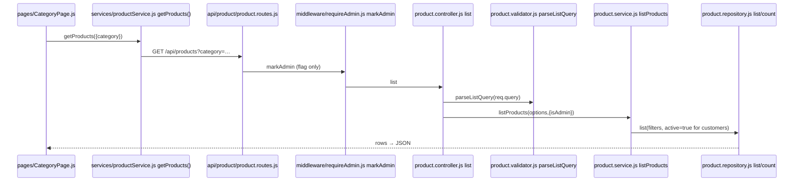
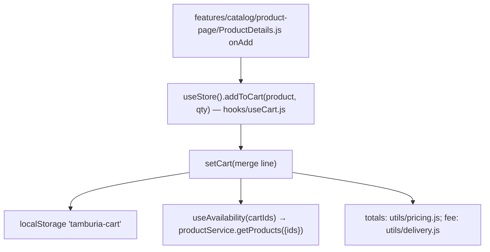
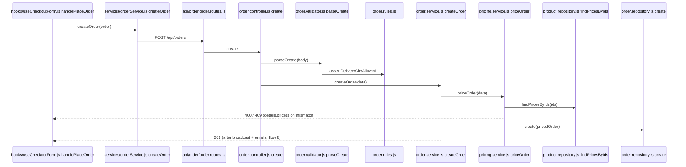
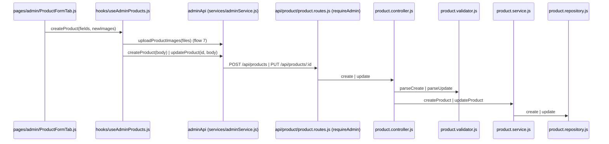
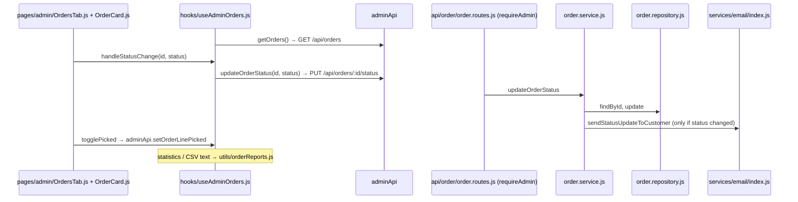

# Technic Tambur — Target Architecture (revision 2)

**Status: proposal. Nothing here has been implemented, and no tests were run to produce this revision.** [`REFACTOR_PLAN.md`](REFACTOR_PLAN.md) says how to get here in small steps.

Written for: the project owner, a junior Full Stack developer who wants to understand and explain every part of the application.

**What changed in revision 2** (details in the sections named):

- Far fewer client moves and **no cosmetic renames** (§2, §7). Only extractions that fix a real mix of responsibilities remain.
- The admin 401 mechanism is **redesigned** (§4.2): `setUnauthorizedHandler` is rejected for a concrete ordering bug.
- New **dependency audit** (§11) and **security matrix with validation analysis** (§12).
- New **worked examples** for five requests with real current function names (§6.2).
- Library policy added (§1.2).

How to read it: **[V]** = verified by reading source; **[A]** = assumption or not verifiable statically; **[R]** = needs runtime verification. "Current" names are real; "target" names do not exist yet.

---

## 1. Goals and ground rules

### 1.1 Kept from the approved direction

`client/` and `server/` names; `.js` extensions; React 19, Express 5, PostgreSQL through `pg`; Create React App for now; **classic Redux** (`redux`, `react-redux`, `redux-thunk`; no Redux Toolkit) for the shared storefront state — cart, wishlist, availability — approved after revision 2 (phase P4R, §4.5); **domain folders on the server**; the request path **route → middleware → controller → service → repository → PostgreSQL**; **Repository instead of Model**; frontend parts **pages, components, hooks, services, store (Redux), utils**; no ORM, TypeScript, Redux Toolkit or new framework; small phases with tests and approval between them; **no business-behavior change**.

### 1.2 Library policy (course-aligned engineering)

I do not know which libraries the course covered, so I assume **nothing beyond**: React hooks, Express routes/controllers/middleware/services, authentication with cookies, SQL with `pg`. For everything else this document explains it (§11).

A new library is proposed **only if** all four are written down: (1) the problem it solves, (2) why the current code is insufficient, (3) whether a simple function would do, (4) what the owner must learn to maintain it. **The only new dependencies are `redux`, `react-redux` and `redux-thunk` (decision D11, phase P4R); no other dependency is proposed.** Where a library was considered (Zod, bcrypt, Cryptr, express-session, helmet, a CSRF package) §12 explains why it is not recommended now.

### 1.3 Structural rules

1. The frontend talks to the backend only through `services/`.
2. Pages and components never call `fetch`; hooks call services.
3. Pure calculations live in `utils/`, not inside hooks or components.
4. The backend is grouped **by domain**.
5. Business rules live in services (or one small rules file); validators only check shape.
6. A file moves only if it improves navigation, consistency or a responsibility boundary. Components are **not** split because they are long.

---

## 2. Target directory tree

Only what changes is annotated. Everything else stays where it is today.

```
tamburia-store/
├─ client/                                   (unchanged name)
│  └─ src/
│     ├─ index.js, css/, assets/             unchanged
│     └─ js/
│        ├─ App.js                           Provider + routes (the state composition moves to the Redux store, P4R)
│        ├─ StoreLayout.js                   the storefront frame; after P4R also holds the checkout form and the menu state
│        ├─ store/          NEW (P4R, classic Redux): index.js  rootReducer.js  persistence.js
│        │                  cart/ wishlist/ availability/ → <name>Actions.js  <name>Reducer.js  <name>Selectors.js
│        │                  (replaces context/storeContext.js, which is deleted at the end of P4R)
│        ├─ pages/          unchanged; admin/ also receives AdminLogin.js and AdminRoute.js (optional, 2 moves)
│        │  └─ admin/       Admin.js, *Tab.js, OrderCard, PickList, … (names unchanged)
│        ├─ components/     unchanged (generic UI)
│        ├─ features/       unchanged (cart, catalog, home, calculators — already "by domain")
│        ├─ hooks/          admin hooks simplified (§8); useCart and useWishlist removed in P4R (useAvailability stays, for the recently viewed list)
│        │                  (useCheckoutForm stays, reads the cart through selectors)
│        ├─ services/       http.js, productService, orderService, reviewService, pigmentService,
│        │                  authService (unchanged names) + adminService.js (NEW)
│        └─ utils/          unchanged + orderReports.js, productCsv.js, paintCalc.js, delivery.js (NEW)
│
├─ server/                                   (unchanged name)
│  ├─ server.js, app.js, config/, db/        unchanged (app.js: one import path)
│  ├─ api/                                   NEW: the five/three/… files of each domain together
│  │  ├─ index.js                            (was routes/index.js) mounts domains + GET /health
│  │  ├─ product/   product.routes.js  product.controller.js  product.service.js
│  │  │             product.repository.js  product.validator.js
│  │  ├─ order/     order.routes/.controller/.service/.repository/.validator
│  │  │             order.rules.js           NEW: delivery area + status rules (shared by validator and service)
│  │  │             pricing.service.js       (moved)
│  │  ├─ review/    (same five files)
│  │  ├─ pigmentFormula/  (same five files)
│  │  ├─ setting/   (same five files)
│  │  ├─ auth/      auth.routes/.controller/.service/.validator     (no repository: password is in env)
│  │  └─ upload/    upload.routes.js  upload.controller.js          (no repository: files, not tables)
│  ├─ middleware/   requireAdmin  rateLimit  validate  errorHandler  securityHeaders  upload (thin)
│  ├─ services/     email/  storage/  image.service.js  realtime.service.js     (shared infrastructure, unchanged place)
│  └─ utils/        AppError  money  paginate  originals  categories           (categories loads a JSON file)
│
├─ scripts/, test/                           imports and paths updated, logic unchanged
└─ docs                                      README, docs/ARCHITECTURE.md, .doc/*, AGENTS.md, .claude/rules/naming.md — updated by the plan
```

**Count of new files:** server **1** (`order.rules.js`) + client **5** (`adminService.js`, `orderReports.js`, `productCsv.js`, `paintCalc.js`, `delivery.js`) + **12 for the Redux store** (`store/index.js`, `rootReducer.js`, `persistence.js` and, for each of cart, wishlist and availability, an actions, a reducer and a selectors file) + 1 data file (`categories.json`, §7.1). Everything else is moved or edited. `StoreProvider.js` (optional P4 item) is **dropped**: the Redux `Provider` replaces it.

**Dropped from revision 1** (cosmetic, risk without gain): `features/ → components/<area>/`; `Admin.js → AdminDashboard.js`; `*Tab.js → Admin*.js`; moving admin sub-components out of `pages/admin/`; `*Service.js → *.service.js` on the client; `http.js → http.service.js`; function renames in `authService`; merging `apiErrors.js` into `http.js`; `utils/productForm.js`.

---

## 3. The request path, in plain words

```
page/component → hook → frontend service → route → middleware → controller
→ (validator) → backend service → repository → PostgreSQL        (response returns the same way)
```

| Layer | One-sentence job | Plain example |
|---|---|---|
| Page / component | Shows something and reacts to clicks. | The "Place order" button. |
| Hook | Holds state and effects for a screen. | `useCheckoutForm` remembers the form and "sending…". |
| Frontend service | One function per backend call. | `createOrder(order)` sends `POST /api/orders`. |
| Route | Says which URL and verb go to which controller, and who may call it. | `PUT /api/orders/:id/status` is admin-only. |
| Middleware | A check that runs before the controller. | `requireAdmin`, rate limit. |
| Controller | Reads the request, calls validator and service, sends the answer. | `orderController.create`. |
| Validator | Checks the *shape* of input. | Phone has 9–15 digits. |
| Service | Business rules: what is allowed and what happens. | Prices come from the DB, not the browser. |
| Repository | SQL. Nothing else. | `findByIdAndPhone(id, phone)`. |

Layers can be skipped when empty: login has no repository (password is in the environment); image upload has none (files, not tables); cart operations never reach the server.

---

## 4. Responsibilities

### 4.1 Frontend

| Part | Does | Must not |
|---|---|---|
| **pages/** | Choose components/hooks for one route; read the URL. | Call `fetch`; hold business logic. |
| **components/**, **features/** | Draw UI, react to clicks. | Build URLs; compute statistics or prices. |
| **hooks/** | State and effects; call services. | Call `fetch` directly; mix unrelated work. |
| **services/** | One function per backend call; errors become `ApiError`. | Touch React or the DOM. |
| **store/** (Redux, P4R) | Shared storefront state that survives navigation: cart, wishlist, availability. Plain actions, pure reducers, selectors, two thunks. | Call `fetch` (thunks call services); hold admin or form state; mutate state. |
| **utils/** | Pure functions. | Import React or call the network. |

### 4.2 Admin HTTP and the 401 problem (decision)

**Today [V]:** `Admin.js` builds `api = (url, options) => fetch(...)` that, on status 401, calls `onExpired` (which makes `AdminRoute` show the login form) and returns the response. The three admin hooks receive `api` as an argument and each builds its own requests (`useAdminOrders`, `useAdminProducts`, `useAdminReviews`, plus `useStatsBaseline`). `/auth/login` and `/auth/me` go through `authService`, **not** through `api`, because there a 401 is the answer, not an expiry.

**Options compared**

| Option | How | Problems |
|---|---|---|
| A. `setUnauthorizedHandler(fn)` in the HTTP service (revision 1) | Module-level callback registered by `AdminRoute`. | **Global mutable state; real ordering hazard.** React runs child effects before parent effects. The admin hooks (inside `Admin`, a child of `AdminRoute`) fire their first `GET` in their effect *before* `AdminRoute`'s effect could register the handler, so an expired session on first load would be ignored. Also couples a plain module to React auth state. **Rejected.** |
| B. Keep today's `api` wrapper, hooks keep building requests | No change. | Works, but hooks keep the duplicated `fetch` + `res.ok` + `catch` code that the owner wants removed. Acceptable fallback. |
| C. Services throw `ApiError`; each hook checks `status === 401` | Hook calls `onExpired` itself. | ~15 repeated checks; easy to forget in a new call. |
| **D. `createAdminApi(onUnauthorized)` — chosen** | `adminService.js` exports one function that **returns an object of admin calls** (`getOrders`, `updateOrderStatus`, `setOrderLinePicked`, `deleteOrder`, `getProducts`, `createProduct`, `updateProduct`, `patchProduct`, `deleteProduct`, `uploadProductImages`, `getReviews`, `approveReview`, `deleteReview`, `getSetting`, `saveSetting`). `Admin.js` creates it once (`useMemo`) with `() => expiredRef.current?.()` and passes it to the hooks **in place of `api`**. | Slightly more wiring than A, but: no global state; no React inside the service; same wiring shape as today (Admin creates it, hooks receive it); tests pass a fake object. |

**Why D:** it is the smallest change from the current design that still removes request-building from the hooks. It is plain JavaScript (a function that returns functions), no new concept.

**Behavior that must be preserved** (each becomes a test in the plan, P1/P2):

1. A 401 from any admin call → `onUnauthorized()` runs, then the hook still shows the same message it shows today (`'נדרשת התחברות כמנהל'` from the server body) — i.e. the order "expire, then report the error" is kept.
2. **Login errors:** `loginAdmin`/`authService.login` is **not** wrapped, so a wrong password stays a normal error (`'סיסמה שגויה — נסה שוב'` / server message) and does not trigger "expired".
3. `isLoggedIn()` (`/auth/me`) is unchanged: any failure means "not logged in".
4. **Non-OK list responses** keep today's exact outcomes: orders → empty list (`useAdminOrders.loadOrders`), reviews → empty list, products → list left unchanged (`useAdminProducts.fetchProducts` returns early). Network errors in `loadOrders` stay silent.
5. Every user-facing fallback message (`'שינוי הסטטוס של הזמנה #… נכשל.'`, `'מחיקת הביקורת נכשלה.'`, …) stays byte-identical; `NETWORK_ERROR` stays for failures with no response.
6. Request URL, method, headers and body of every call stay identical; the image upload sends `FormData` with **no** manual `Content-Type`.
7. The WebSocket (`useWebSocket`) and the 120-second poll are untouched.

### 4.3 Backend

| Part | Does | Must not |
|---|---|---|
| **routes** | URLs, verbs, middleware order, controller. | Contain logic. |
| **controllers** | Read request → validator → **one** service call → response. No `try/catch` (Express 5 forwards rejected promises). | Import a repository; write SQL; decide rules. |
| **validators** | Shape: type, length, allowed values, normalise → `badRequest`. | Business rules, prices. |
| **services** | Rules and orchestration (pricing, visibility, moderation, who gets which email). | Know `req`/`res`; write SQL. |
| **repositories** | Parameterised SQL, explicit columns, filter/sort/paginate, transactions. | HTTP; emails; rules. |
| **middleware** | Admin guard, rate limit, `idParam`, multer, security headers, error handler. | Domain logic (image processing leaves). |
| **services/ (shared)** | `email/`, `storage/`, `image.service.js`, `realtime.service.js`. | Import a domain's repository. |

### 4.4 The "Repository" convention

`*.model.js` → `*.repository.js`; in services `const Order = require('../models/order.model')` becomes `const orderRepository = require('./order.repository')`. **No SQL is rewritten and no function is renamed** (`list`, `count`, `findById`, `create`, `update`, `remove`, …). *Repository* is added to `.doc/glossary.md` before the first rename (project rule). `auth` and `upload` have no repository.

### 4.5 Shared storefront state: classic Redux (phase P4R)

**Decision (D11, approved after revision 2):** classic Redux — `redux`, `react-redux`, `redux-thunk` — for the data that is genuinely shared across storefront screens. No Redux Toolkit, no `createSlice`, no TypeScript. Full detail, migration order and acceptance criteria: `.plan/001-2026-11-13-redux-store.md`.

**State shape**

```js
{
  cart:         { items: [ /* same line objects as today */ ], deliveryMethod: null /* | 'pickup' | 'delivery' */ },
  wishlist:     { ids: [] },
  availability: { unavailableIds: [] },   // sorted number[]; a Set is not serializable
}
```

Derived values (`cartCount`, `subtotal`, `deliveryFee`, `total`, the `Set` of unavailable ids) are selectors, not state; they use `utils/pricing.js` and `utils/delivery.js` unchanged.

**Files** (`client/src/js/store/`): `index.js` (`createStore` with `applyMiddleware(thunk)`), `rootReducer.js` (`combineReducers`), `persistence.js`, and for each of `cart/`, `wishlist/`, `availability/` one `…Actions.js` (action-type constants, action creators, thunks), one `…Reducer.js`, one `…Selectors.js`. Two thunks only: `toggleWishlist` (same `localStorage` read-modify-write as today) and `checkAvailability` (calls `productService.getProducts`, returns the abort function).

**What stays outside Redux, and why**

| State | Stays | Why |
|---|---|---|
| Admin data (`useAdmin*`, `useStatsBaseline`) and admin session (`AdminRoute`) | Local hooks / component | Own lifetime, one consumer tree, already behind `adminService`; the 401 callback is wired by `createAdminApi` |
| Checkout form fields and submit | `useCheckoutForm`, called in `StoreLayout`, passed to `CartModal` as a prop | They must outlive `CartModal` (it unmounts when the drawer closes), and `StoreLayout` is the nearest component that does; no global state needed |
| `menuOpen` | `useState` in `StoreLayout`, props to `Navbar` | Shared by exactly two components, one the parent of the other |
| Recently viewed, the wishlist drawer's own list | As today | One component each; the drawer's `localStorage` path is preserved (backlog) |

**Rules:** components read with narrow `useSelector` calls and write with `dispatch`; reducers are pure and return the same reference when nothing changes; services, `http.js`, `utils/`, HTTP contracts, messages and `localStorage` persistence are unchanged; known bugs (BF-01 and others) are not fixed by this phase.

---

## 5. Current vs. target

| Area | Current | Target |
|---|---|---|
| Backend grouping | By layer (`routes/`, `controllers/`, `services/`, `models/`, `validators/`) | By domain: `api/<domain>/` |
| Persistence | `models/*.model.js` | `api/<domain>/*.repository.js` |
| Order rules | In `order.validator.js`, imported by `order.service.js` | `order.rules.js` imported by both |
| Image upload | `middleware/upload.js` runs sharp and storage | Middleware = multer only; `image.service.js` processes and stores |
| Categories | Server `eval`s a client source file | `categories.json` both sides load |
| Product filters | Written twice (`list`, `count`) | One `buildFilters()` |
| Admin HTTP | Raw `fetch` in 4 hooks | `adminService.createAdminApi()` |
| Statistics, CSV, paint maths | Inside two hooks and one component | `utils/orderReports.js`, `productCsv.js`, `paintCalc.js` |
| Delivery fee / cities (client) | In `useCart.js` and `CheckoutFormView.js` | `utils/delivery.js` |
| Shared storefront state | Hooks `useCart`, `useWishlist`, `useAvailability` merged into one Context in `App.js` (`useAvailability` also serves the recently viewed list and stays for it) | Classic Redux store (`store/`): cart, wishlist, availability; checkout form and menu state local to `StoreLayout` |
| `App.js` | Routes + state composition | `Provider` + routes |
| Folder names, extensions | `client/`, `server/`, `.js` | unchanged |

---

## 6. Request flows

Current flows 1–6 are drawn in [`ARCHITECTURE_AUDIT.md` §5](ARCHITECTURE_AUDIT.md). Section 6.1 shows the **target** for all eight flows (client names are unchanged unless noted); §6.2 walks five of them layer by layer with **current** and **target** names side by side.

### 6.1 Target diagrams

**1. Browsing products**



**2. Adding to cart (browser only)**



**3. Guest checkout**



**4. Admin login**

```mermaid
sequenceDiagram
    participant Guard as AdminRoute.js
    participant Login as AdminLogin.js
    participant Svc as services/authService.js (isLoggedIn / login)
    participant Route as api/auth/auth.routes.js
    participant RL as middleware/rateLimit.js
    participant Ctl as auth.controller.js login
    participant Sv as auth.service.js
    Guard->>Svc: isLoggedIn()  → GET /api/auth/me (requireAdmin)
    Login->>Svc: login(password) → POST /api/auth/login
    Route->>RL: loginLimiter
    RL->>Ctl: login
    Ctl->>Sv: passwordMatches(), createToken()
    Ctl-->>Login: Set-Cookie httpOnly; SameSite=Strict; Secure (production)
```

**5. Admin creates / edits a product**



**6. Admin manages orders**



**7. Image upload** — *current:* `middleware/upload.js` runs multer **and** processing; *target:* processing moves to a service.

```mermaid
sequenceDiagram
    participant Hook as hooks/useAdminProducts.js uploadImages
    participant Adm as adminApi.uploadProductImages (FormData)
    participant Route as api/upload/upload.routes.js
    participant MW as middleware/upload.js (multer only)
    participant Ctl as upload.controller.js uploadMultiple
    participant Img as services/image.service.js saveUploadedImages (NEW; was processUploads)
    participant St as services/storage (local | cloudinary)
    Hook->>Adm: uploadProductImages(files)
    Adm->>Route: POST /api/upload-multiple
    Route->>MW: requireAdmin → multer(memory)
    MW->>Ctl: req.files
    Ctl->>Img: saveUploadedImages(files)
    Img->>St: saveProcessed + saveOriginal (original failure only logged)
    Ctl-->>Hook: {imageUrls}
```

**8. Order notifications** — identical today and in the target (only file locations differ): `order.service.createOrder` → `realtime.service.broadcast('order:created')` → `ws` clients → `useWebSocket` → `useAdminOrders` (confetti + chime + reload); and → `services/email` (`sendNewOrderToStore`, `sendOrderConfirmationToCustomer`) → nodemailer; email failures return `{sent:false}` and never fail the order.

### 6.2 Worked examples (current name → target name)

**Example 1 — Fetching products** (`GET /api/products?category=painting`)

| # | Layer | Current [V] | Target |
|---|---|---|---|
| 1 | Page | `pages/CategoryPage.js` effect | same |
| 2 | Frontend service | `services/productService.js` `getProducts` → `http.js` `getJson` | same |
| 3 | Route | `server/routes/product.routes.js` `router.get('/', markAdmin, controller.list)` | `server/api/product/product.routes.js` |
| 4 | Middleware | `requireAdmin.js` `markAdmin` (sets `req.isAdmin`, never rejects) | same |
| 5 | Controller | `product.controller.js` `list` | `api/product/product.controller.js` |
| 6 | Validator | `product.validator.js` `parseListQuery` | `api/product/product.validator.js` |
| 7 | Service | `product.service.js` `listProducts` (non-admin ⇒ `active = true`) | `api/product/product.service.js` |
| 8 | Repository | `models/product.model.js` `list` (+ `count` if paged) | `api/product/product.repository.js` (`buildFilters`) |
| 9 | DB | `SELECT … FROM products WHERE active = $1 AND category = $2 ORDER BY …` | same |

**Example 2 — Creating an order** (`POST /api/orders`)

| # | Layer | Current [V] | Target |
|---|---|---|---|
| 1 | Hook | `hooks/useCheckoutForm.js` `handlePlaceOrder` | same |
| 2 | Frontend service | `services/orderService.js` `createOrder` → `postJson` | same |
| 3 | Route | `routes/order.routes.js` `router.post('/', controller.create)` (**no rate limit**, see SEC-01) | `api/order/order.routes.js` |
| 4 | Controller | `order.controller.js` `create` | `api/order/` |
| 5 | Validator | `order.validator.js` `parseCreate` (shape + delivery-area check) | `order.validator.js` using `order.rules.js` |
| 6 | Service | `order.service.js` `createOrder` | `api/order/order.service.js` |
| 7 | Pricing | `pricing.service.js` `priceOrder` (server prices, 409 on mismatch) | `api/order/pricing.service.js` |
| 8 | Repository | `product.model.js` `findPricesByIds`; `order.model.js` `create` | `product.repository.js`, `order.repository.js` |
| 9 | Side effects | `realtime.service.broadcast`, `services/email` | same |

**Example 3 — Admin updates a product** (`PUT /api/products/:id`)

| # | Layer | Current [V] | Target |
|---|---|---|---|
| 1 | Component | `pages/admin/ProductFormTab.js` save | same |
| 2 | Hook | `hooks/useAdminProducts.js` `updateProduct` | same, but calls `adminApi.updateProduct` |
| 3 | Frontend service | **raw `api('/api/products/' + id, {method:'PUT', …})`** from `Admin.js` | `adminService.js` `createAdminApi(...).updateProduct` |
| 4 | Route | `product.routes.js` `router.put('/:id', requireAdmin, idParam, controller.update)` | `api/product/` |
| 5 | Controller → validator | `update` → `parseUpdate` (only sent fields; price from cheapest variant) | same |
| 6 | Service | `product.service.js` `updateProduct` (`checkSubcategoryUpdate`) | same |
| 7 | Repository | `product.model.js` `update` (`SET col = $n` for validated keys) | `product.repository.js` |

**Example 4 — Authenticating an admin**

| # | Layer | Current [V] | Target |
|---|---|---|---|
| 1 | Page | `pages/AdminLogin.js` → `authService.login(password)` | same (file optionally moves to `pages/admin/`) |
| 2 | Route | `auth.routes.js` `router.post('/login', exposeReset, loginLimiter, controller.login)` | `api/auth/auth.routes.js` |
| 3 | Middleware | `rateLimit` (10 tries / 15 min per IP, reset on success) | same |
| 4 | Controller | `auth.controller.js` `login`: `parseLogin` → `passwordMatches` → `createToken` → `res.cookie(…)` | same |
| 5 | Service | `auth.service.js` `passwordMatches` (SHA-256 digests + `timingSafeEqual`), `createToken` (HMAC-SHA256), `cookieOptions` | same |
| 6 | Persistence | **none** — password comes from `config.auth.password` (environment) | same (no repository) |
| 7 | Later requests | `requireAdmin` → `readCookie` → `verifyToken` → `req.admin` | same |
| 8 | Browser guard | `routes/AdminRoute.js` → `authService.isLoggedIn()` → `GET /api/auth/me` | same |

**Example 5 — Uploading an image**

| # | Layer | Current [V] | Target |
|---|---|---|---|
| 1 | Hook | `useAdminProducts.uploadImages` builds `FormData` and calls `api(...)` | `adminApi.uploadProductImages(files)` |
| 2 | Route | `upload.routes.js` `requireAdmin, upload.array('images', 5), processUploads, controller.uploadMultiple` | `api/upload/upload.routes.js` |
| 3 | Middleware | `middleware/upload.js`: multer (memory, ≤15 MB, ≤5 files, extension + MIME filter) **and `processUploads`** | multer + filter only |
| 4 | Service | `image.service.js` `prepareImage` (HEIC check, `sharp` decode → 1200 px → square → WebP → hash name) | + `saveUploadedImages` (the loop from `processUploads`) |
| 5 | Storage | `storage.saveProcessed`, `saveOriginal` (local or Cloudinary) | same |
| 6 | Response | `upload.controller.js` `uploadMultiple` → `{ imageUrls }` | same |

---

## 7. Existing → target file mapping

Legend: **K** keep, **M** move, **R** rename, **S** simplify, **N** new.

### 7.1 Server

| Existing | Target | Action |
|---|---|---|
| `server.js`, `app.js`, `config/*`, `db/*` | same | K (`app.js`: router import) |
| `routes/index.js` | `api/index.js` | M |
| `routes/<d>.routes.js`, `controllers/<d>.controller.js`, `validators/<d>.validator.js`, `services/<d>.service.js` for order, product, review, pigmentFormula, setting, auth, upload | `api/<d>/…` | M |
| `services/pricing.service.js` | `api/order/pricing.service.js` | M |
| `models/<d>.model.js` ×5 | `api/<d>/<d>.repository.js` | **R**+M |
| `services/{email,storage}/*`, `realtime.service.js` | same | K |
| `services/image.service.js` | same | S (+ `saveUploadedImages`) |
| `middleware/{requireAdmin,rateLimit,validate,securityHeaders}.js` | same | K |
| `middleware/errorHandler.js`, `middleware/upload.js` | same | S |
| `utils/categories.js` | same | S (`require` JSON) |
| `utils/{AppError,money,paginate,originals}.js` | same | K |
| `api/order/order.rules.js` | — | N |
| `client/src/js/features/catalog/categories.js` | stays; imports new `categories.json` | S + N (data) |

### 7.2 Client

| Existing | Target | Action | Practical benefit |
|---|---|---|---|
| `js/hooks/useAdminOrders.js`, `useAdminProducts.js`, `useAdminReviews.js`, `useStatsBaseline.js` | same files | S | Call `adminApi` instead of building requests; shorter. |
| (stats, CSV code inside them) | `utils/orderReports.js`, `utils/productCsv.js` | N | Pure functions you can read and test without React. |
| `features/calculators/PaintCalculator.js` | same | S | Maths → `utils/paintCalc.js`; component keeps state + JSX. |
| (new) | `services/adminService.js` | N | The one place admin requests are written. |
| `hooks/useCart.js`, `features/cart/CheckoutFormView.js` | same | S | `DELIVERY_FEE`, `ALLOWED_CITIES` → `utils/delivery.js` (one client source). |
| `pages/admin/Admin.js` | same | S | Drops the `api` wrapper; creates `adminApi`. |
| `App.js` | same | S (optional) | Routes only; composition in `context/StoreProvider.js` (N). |
| `pages/AdminLogin.js`, `routes/AdminRoute.js` | `pages/admin/` | M (optional) | The admin entry (guard + login) sits with the admin screens; removes a one-file folder. |
| everything else (components, features, other pages, other services, utils, css, tests) | same place, same name | **K** | Already single-purpose; moving them would only churn imports. |

---

## 8. Simplification decisions (major files)

| File | Decision | Why it is easier afterwards |
|---|---|---|
| `useAdminOrders.js` (263 lines) | **S**: keep fetch state, WebSocket, polling, confetti, optimistic pick list; move `getStats` and CSV-text building to `utils/orderReports.js`; the Blob download stays. | A hook is about state; statistics are plain arithmetic. |
| `useAdminProducts.js` (333) | **S**: `adminApi` calls; `parseCSV` → `utils/productCsv.js`. | Removes the repeated request code. |
| `useAdminReviews.js` (55) | **S**: `adminApi` calls. | Same pattern. |
| `PaintCalculator.js` (456) | **S** only: maths out; **not** split into more components. | Component = screen; `paintCalc` = formulas. |
| `ProductFormTab.js` (399) | **K** (no change in the refactor). It has one job: the product form. `formProblem`/`fieldsFromProduct` stay. | Avoids touching a working form for aesthetics. |
| `Admin.js` (225) | **S**: creates `adminApi`, no `api` wrapper. | Shell + tabs. |
| `order.validator.js` (408) | **S**: rules → `order.rules.js`. | Validator = shape. |
| `product.model.js` → repository | **S**: one `buildFilters()`. | One place to add a filter. |
| `middleware/upload.js` | **S**: multer only. | Middleware = HTTP. |
| `pricing.service.js`, `realtime.service.js`, `storage/*`, `email/*`, `useCart.js` (merge fix is BF-01), `StoreLayout.js`, `scripts/import-products.js` | **K** | Correct and single-purpose. |

---

## 9. How this matches standard patterns

- **Layered backend** (route → controller → service → repository) is the standard Express pattern; each layer depends only on the one below.
- **Service layer:** "where is the price decided?" → one file, `pricing.service.js`.
- **Repository** here means only "the file that holds the SQL for one domain"; plain functions over `pg`.
- **Domain folders:** everything about orders is in `api/order/`.
- **React:** pages compose components; hooks hold state; services talk HTTP; utils are pure; the Redux store shares the cart, wishlist and availability. No extra libraries beyond `redux`, `react-redux` and `redux-thunk`.

Interview one-liner: *"The browser calls a service function, which hits an Express route; middleware runs, a controller validates and calls a service where the rules live; the service uses a repository that runs parameterised SQL on PostgreSQL."*

---

## 10. Module guide

For each module: **what/why**, **talks to**, **in → out**, **example**. (Names are current; paths change only for server domain files.)

| Module | What / why | Talks to | In → Out | Example |
|---|---|---|---|---|
| `server.js` | Start in the right order. | `config/db`, `db/migrate`, `app`, `realtime.service` | env → running server | DB ✓ → migrations ✓ → port. |
| `app.js` | Order of `app.use` is the policy. | middleware, router, static | — → app | Unknown `/api/x` → JSON 404. |
| `config/env.js` | Only reader of env vars; fails fast. | all | `process.env` → `config` | `DELIVERY_FEE` → `config.orders.deliveryFee`. |
| `config/db.js` | One pool; `query`, `withTransaction`. | repositories | SQL → rows | — |
| routes | URLs, verbs, guards. | middleware, controller | request → controller | admin-only status change. |
| controllers | HTTP ↔ service. | validator, service | `req` → `res` | `create` → `201`. |
| validators | Shape of input. | `AppError` | body → clean data | phone 9–15 digits. |
| `order.rules.js` (new) | Rules shared by validator and service. | both | address/status → ok or 400 | "Shipped" for a pickup order → 400. |
| `order.service.js` | Order workflow. | pricing, repository, email, realtime | data → order | create → broadcast → emails. |
| `pricing.service.js` | Server decides prices. | product repository | items → priced order or 400/409 | browser says 25, DB says 27 → 409. |
| `product.service.js` | Hide vs delete, visibility. | repository, storage | id → product | hidden product → same 404. |
| `review.service.js` | Moderation. | repository | review → saved | public list approved-only. |
| `auth.service.js` | Token, password check, cookie. | `requireAdmin`, `realtime` | password/token → bool/payload | cookie valid 12 h. |
| repositories | SQL. | `config/db` | params → rows | `findByIdAndPhone`. |
| `requireAdmin` / `markAdmin` | Guard / flag. | `auth.service` | cookie → `req.admin` | `?active=all` honoured for admin only. |
| `rateLimit` | Per-IP counter in memory. | routes | request → 429 | login 10 / 15 min. |
| `errorHandler` | Any error → JSON. | `AppError` | error → `{error}` | `conflict` → 409 + prices. |
| `image.service` | Photo → WebP, hash name. | storage | bytes → URL | same photo → same URL. |
| `storage/` | Local disk or Cloudinary. | image, product service | file → URL | `STORAGE_DRIVER`. |
| `email/` | Build and send mail; never throws. | order service | order → `{sent}` | "shipped" email. |
| `realtime.service` | WebSocket broadcast; knows no orders. | order service | event → admin sockets | new-order chime. |
| `App.js` / `StoreLayout.js` | Routes / frame + URL-driven modals. | `useStore` | URL → UI | `/cart` opens the cart over home; Back closes. |
| `hooks/useCart` | Cart + localStorage. | `utils/pricing` | add/remove → totals | 3 × 12.90 = 38.70. |
| `hooks/useCheckoutForm` | Form, submit, 409 handling. | `orderService` | form → order/err | price changed → cart updated. |
| `hooks/useAdmin*` | Admin data. | `adminApi`, utils | actions → state | status change → refetch. |
| `services/http.js` | One way to call the API. | `fetch` | URL/body → JSON or `ApiError` | 409 → `error.details.prices`. |
| `services/adminService.js` (new) | All admin calls; 401 → login. | `http.js` | args → JSON | `updateProduct(5, {price: 12.9})`. |
| `utils/*` | Pure helpers. | — | values → values | `ordersToCsv(orders)`. |

---

## 11. Dependency audit

Sources: `package.json`, `package-lock.json` (lockfileVersion 3), `client/package.json`, `client/package-lock.json` of this repository. **Checked [V]:** both lockfiles' root entries match their `package.json` dependency lists exactly, and the locked versions match the ranges. **Not done:** no install, no `npm audit` (needs the registry), no upgrade check, so known-vulnerability status is **[R] unknown**. There is no separate `server/package.json`; the root manifest is the server's.

**Not present anywhere [V: grep of both manifests and of `server/`, `client/src/`, `scripts/`, `test/`]:** bcrypt, argon2, Cryptr, jsonwebtoken, express-session, helmet, csurf/csrf packages, Zod/Joi/Yup/express-validator, axios, morgan/winston/pino, passport, an ORM. (Redux was also absent when this audit was made; `redux`, `react-redux` and `redux-thunk` are added by phase P4R, §4.5, decision D11.) Everything those would do is done by Node built-ins (`crypto`) and hand-written code.

### Server (root `package.json`)

| Library (locked) | Purpose | Where used | Essential? | Keep? | Complexity added | Replace / remove? |
|---|---|---|---|---|---|---|
| `express` 5.2.1 | HTTP server, routing; Express 5 forwards async errors, so controllers need no `try/catch` | `app.js`, all routes | Yes | **Keep** | Low | No |
| `pg` 8.20.0 | PostgreSQL driver (pool, parameterised queries) | `config/db.js`, `db/migrate.js` | Yes | **Keep** | Low (plain SQL) | No ORM, as decided |
| `dotenv` 17.4.2 | Loads `.env` into `process.env` | `config/env.js` | Yes (Node ≥18 engine; built-in `--env-file` needs newer Node) | **Keep** | None | No |
| `cors` 2.8.6 | CORS headers | `app.js` `corsOptions` (production: allow-list or none) | Practically optional: production is same-origin and the CRA dev proxy is same-origin | **Keep** (tiny, standard) | None | Could be removed later if never used cross-origin; not worth it |
| `multer` 2.1.1 | Parses `multipart/form-data` uploads (Express cannot) | `middleware/upload.js` | Yes, for image upload | **Keep** | Low–medium (memory storage, filters) | No |
| `sharp` 0.35.4 | Resize / re-encode images to WebP, strip metadata (native binary) | `services/image.service.js` | Yes for the photo pipeline | **Keep** | Medium (native module; the one heavy dependency) | No built-in Node alternative |
| `nodemailer` 8.0.3 | Sends email over SMTP (configured for Gmail) | `services/email/transporter.js` | Yes for email notifications | **Keep** | Low | No |
| `ws` 8.21.3 | WebSocket server for the live new-order notification | `services/realtime.service.js` | Optional feature: a 120 s poll already exists as fallback | **Keep** | Medium (needs understanding of the HTTP upgrade) | Polling-only is simpler but loses the instant chime; Server-Sent Events would avoid the library but is a rewrite. Not recommended |
| `cloudinary` 2.11.0 | Cloud image storage driver | `services/storage/cloudinary.driver.js`, loaded via `storage/index.js` | Only when `STORAGE_DRIVER=cloudinary` | **Keep** (needed for cloud deploy) | Low | Could become an optional dependency; no action now |

### Server, development only

| Library | Purpose | Where | Keep? | Note |
|---|---|---|---|---|
| `@imgly/background-removal-node` 1.4.5 | Cut-out of product photos | `scripts/lib/cutout*.js` (photo pipeline) | Keep as dev | Large machine-learning dependency; irrelevant to the running store |
| `exceljs` 4.4.0 | Reads/writes the shooting-day and new-products spreadsheets | `scripts/products-new-template.js`, `scripts/products-import-new.js` | Keep as dev | — |
| `axe-core` 4.13.0, `puppeteer-core` 25.12.0 | Accessibility audit (`npm run a11y`) | `scripts/a11y-audit.js` | Keep as dev | `puppeteer-core` needs a locally installed Chrome |

### Client (`client/package.json`)

| Library (locked) | Purpose | Essential? | Keep? | Complexity / note |
|---|---|---|---|---|
| `react`, `react-dom` 19.2.4 | UI | Yes | **Keep** | — |
| `react-router-dom` 7.18.4 | URL routing, URL-driven modals | Yes | **Keep** | Medium (data APIs unused) |
| `lucide-react` 1.48.0 | Icons (mandated by `.claude/rules/ui-and-styling.md`) | Yes | **Keep** | — |
| `react-scripts` 5.0.1 (Create React App) | Build, dev server, Jest | Yes today | **Keep for now** (decision) | **CRA is no longer maintained and pulls ~1,300 packages** (lockfile has 1,316 `node_modules/` entries vs 305 for the server). Moving to another build tool would be a separate decision, not part of this refactor |
| `@testing-library/react`, `/dom`, `/jest-dom` | Component tests | Dev | **Keep** | — |

**Where explanation will be needed for the owner** (course coverage unknown): `ws` (HTTP "upgrade" and `broadcast`), `sharp`, `multer`, `nodemailer`, `cloudinary`, and the fact that CRA hides the webpack/Jest configuration.

---

## 12. Security review

**Method and limits:** static reading of the files named below, plus the project's own tests by name (not executed). **This is not a claim that the application is secure.** Runtime behavior (HTTPS proxies, browsers, real headers, dependency vulnerabilities) is marked **[R]**.

Status values: **Implemented (verified by code inspection)** · **Partial** · **Missing** · **Requires runtime verification** · **Not applicable**.
Priority: **Before launch** (public production) · **Soon** · **Later** · **Optional**.

### 12.1 Security matrix

| # | Mechanism | Existing implementation | Files | Status | Risk found | Recommendation | Priority | New dependency? |
|---|---|---|---|---|---|---|---|---|
| 1 | Admin password check | One shared password from env; compared as SHA-256 digests with `crypto.timingSafeEqual`; production refuses < 12 characters | `auth.service.js` `passwordMatches`; `config/env.js:174-186`; `auth.validator.js` | Implemented (verified) | Password is plain text **in the environment**, so anyone who can read the env can log in. Development has no length rule | Keep. See 12.2 on hashing | Later | No |
| 2 | Password hashing (bcrypt/argon2) | None; **no password is stored in the database** | — | Not applicable | Would protect a *database of users*; there is none | Do not add. If a stored hash is ever wanted, Node's built-in `crypto.scrypt` needs no library | Optional | No |
| 3 | Encryption of stored data (Cryptr etc.) | None; nothing is encrypted at rest | — | Not applicable | No secret needs to be stored reversibly; Cryptr is not installed or used | Do not add | — | No |
| 4 | Session token | Hand-written `base64url(payload).base64url(HMAC-SHA256)`; algorithm fixed in code; signature compared in constant time; `sub === 'admin'` and `exp` checked | `auth.service.js` `createToken`, `verifyToken` | Implemented (verified) | Custom format (small and correct, but custom); no token id, so no per-token revocation | Keep; do not swap in a JWT library | Later | No |
| 5 | Signing secret | `SESSION_SECRET` from env; production refuses to start without it; development generates a random one at each start | `config/env.js:138,176,188` | Implemented (verified); unit-tested by name (`unit-config.js`) | Secret rotation logs everyone out (acceptable) | Keep | — | No |
| 6 | Cookie flags | `httpOnly`, `sameSite: 'strict'`, `secure: config.isProduction`, `path: '/'`, `maxAge` = session TTL | `auth.service.js` `cookieOptions` | Implemented (verified); `HttpOnly` and `SameSite=Strict` asserted by `test/smoke-auth.js`; `Secure` **not** asserted | `Secure` depends on `NODE_ENV=production`; if the host does not set it, cookies are sent without `Secure` and CORS, stack traces and password rules fall back to development behavior | **Runtime check behind HTTPS** (cookie has `Secure`; login persists). Add a test with `NODE_ENV=production` for the flag | **Before launch** | No |
| 7 | `SameSite` Strict vs Lax | Strict | same | Implemented (verified) | None found for this app. After landing on `/admin` from an external link, the cookie is withheld only on that first navigation; the page's own `fetch` to `/api/auth/me` is same-site and carries it, so the user stays logged in | **Keep Strict.** Lax would only widen what other sites may trigger | — | No |
| 8 | Session expiry | `SESSION_TTL_HOURS` (default 12) in both token `exp` and cookie `maxAge`; `verifyToken` rejects expired | `config/env.js:139`, `auth.service.js` | Implemented (verified) | 12 h is long for an admin who forgets to log out | Owner decides the value | Later | No |
| 9 | Logout and revocation | `clearCookie` only; the signed token remains valid until `exp` | `auth.controller.js` `logout` | **Partial** | A stolen token (e.g. from a leaked log or device) works up to 12 h after logout | Options in the plan (SEC-05): rotate `SESSION_SECRET` (no code), or store a "valid after" timestamp in the existing `settings` table. Not `express-session` | Soon | No |
| 10 | Auth middleware coverage | `requireAdmin` on every write/admin route; `markAdmin` only flags | all `routes/*.js` | Implemented (verified in route files) | `test/smoke-auth.js` guards 17 routes but not `GET /orders/:id`, `PUT /orders/:id`, `PUT /orders/:id/items/:line/picked`, `GET /reviews/:id`, `PUT /reviews/:id` | Extend the black-box test to every admin route | **Before launch** (tests only) | No |
| 11 | Login rate limit | In-memory per-IP counter, 10 attempts / 15 min, reset on success; `trust proxy` = 1 in production | `middleware/rateLimit.js`, `auth.routes.js`, `app.js:73` | Implemented (verified) | Counters reset on restart and are not shared across instances. **[R]** behind a real proxy the IP must be the visitor's, not the proxy's | Verify with the real host; keep | **Before launch** (runtime check) | No |
| 12 | Rate limit on public writes | **None** on `POST /api/orders` and `POST /api/reviews` | `order.routes.js:29`, `review.routes.js:14` | **Missing** | Order endpoint accepts any `customer_email` and sends mail to it → the shop's mailbox can be used to spam third parties; admin list and moderation queue can be flooded | Reuse `rateLimit()`; limits configurable by env so the test runner is not blocked | **Before launch** | No |
| 13 | Order lookup | Number **and** phone required, one generic 404, 20 / 15 min | `order.routes.js`, `order.service.lookupOrder` | Partial | Name, address and items are visible to anyone who knows both values; order numbers are sequential | Owner decision (one-time code, or accept) | Before launch (decision) | No |
| 14 | CORS | Production: allow-list from `CORS_ORIGINS`, or none; development `origin: true` | `app.js:corsOptions` | Implemented (verified) | Development reflects any origin (no `credentials`, so cookies are not exposed cross-origin) | Keep | — | No |
| 15 | CSRF | No token. Mitigations: `SameSite=Strict`; `express.json` parses only `application/json` (a cross-site form cannot send it without a CORS preflight); production CORS is closed; multipart upload is admin-only and the cookie is not sent cross-site | `auth.service.js`, `app.js` | **Partial** (mitigated, no explicit check) | Same-site attackers (a sibling subdomain, or XSS) are not covered by `SameSite`; WebSocket upgrade has **no Origin check** (only the cookie) | Keep Strict; optionally add a small `Origin`/`Host` check for non-GET requests and the WebSocket upgrade (a few lines, no library). **Do not add a CSRF package now** | Soon (optional) | No |
| 16 | XSS in the React app | No `dangerouslySetInnerHTML`, `innerHTML`, `eval`, `new Function` or `document.write` in `client/src` (grep) | `client/src/**` | Implemented (verified by grep) | React escapes by default | Keep it that way (add a hygiene test) | — | No |
| 17 | XSS in emails | `escapeHtml` applied to name, phone, email, notes, address, item names/colours/sizes; numbers (`id`, `quantity`, prices) are numeric after validation | `email/templates/shared.js`, `newOrder.js`, `orderConfirmation.js`, `orderStatus.js` | Implemented (verified for customer-controlled fields) | Template strings are hand-written, so a future field could be forgotten | Add a test that renders each template with `<script>` in every customer field | Later | No |
| 18 | Content Security Policy | Defined but **off by default** (`CSP_ENABLED=false`); the comment says the built page's JSON-LD `<script>` would be blocked | `securityHeaders.js`, `config/env.js:146` | **Requires runtime verification** | Without CSP there is no second line of defence against injected scripts. The stated reason is doubtful: a JSON-LD block is data, not executed script, and the local `client/build/index.html` currently contains **no inline executable script** (only the JSON-LD block and `<script defer src=…>`). **[R]** must be checked in a browser | Turn on in a browser with `CSP_ENABLED=true`, check the console on every page (including the Google Maps frame and admin), then enable by default in production | **Before launch** (recommended) | No |
| 19 | Other response headers | `nosniff`, `X-Frame-Options: DENY`, `Referrer-Policy`, `Permissions-Policy`, HSTS in production | `securityHeaders.js` | Implemented (verified); `docs/ARCHITECTURE.md` says `smoke-static` asserts them (not read) | HSTS only when `NODE_ENV=production` (see row 6) | Keep; no `helmet` needed | — | No |
| 20 | SQL injection — values | All values pass as `$n` parameters | all `models/*.js`, `db/migrate.js` | Implemented (verified, all five models read) | — | Keep | — | No |
| 21 | SQL injection — identifiers | `ORDER BY ${sort} ${order}` uses whitelisted `sort` (`SORTABLE` in order, product, review, pigment validators) and `ASC`/`DESC`; `INSERT`/`UPDATE` column names come from validator whitelists (`WRITABLE`, `EDITABLE`) or internal code | `*.validator.js`, `*.model.js` | Implemented (verified); **latent**: models trust their callers (an array in `?sort=` is also rejected) | A future caller passing request data straight to `create`/`update` would be injectable | Repositories check column names against their own list (plan P8.6, behavior-neutral) | Soon | No |
| 22 | Input validation | Hand-written per domain; length, type, enum, numeric bounds (`limit ≤ 500`, `ids ≤ 100`, JSON body ≤ 200 KB) | `*.validator.js`, `app.js` | Implemented (verified) | Repeated helpers across files (maintenance, not security) | See 12.3; do not adopt Zod now | Later | No |
| 23 | Upload validation | Extension + MIME allow-list (client-declared); ≤ 15 MB × 5 files; HEIC detected by bytes; **real decoding by sharp** rejects non-images (400); output re-encoded to WebP with metadata stripped; stored name is a content hash (user file names are never used); local paths use `path.basename`; admin-only | `middleware/upload.js`, `image.service.js`, `storage/local.driver.js` | Implemented (verified) | Relies on sharp's default pixel limit (no `limitInputPixels` set in code); up to 75 MB buffered per request (admin only) | Keep; **[R]** try a very large image to confirm it is rejected | Later | No |
| 24 | Secrets and environment | `.env` is git-ignored; `.env.example` holds names; start-up errors print variable **names only**; `unit-repo-hygiene` fails if `.env` or a secret value is tracked; agent hook blocks reading env files | `config/env.js`, `.gitignore`, `test/unit-repo-hygiene.js` | Implemented (verified) | **`client/.env.development` is tracked in Git and was not read** (the guardrail hook blocked it). Anything starting with `REACT_APP_` is public in the bundle | Owner confirms it contains no secret | **Before launch** (owner check) | No |
| 25 | Production error responses | 5xx → generic message in production; pg error codes mapped to 409/400 without internals; 404 JSON | `errorHandler.js` | Implemented (verified) | **Non-production 5xx include the stack** (`errorHandler.js:62`) — dangerous only if production runs without `NODE_ENV=production` (row 6) | Remove the stack (SEC-08) | Soon | No |
| 26 | `NODE_ENV` dependence | `isProduction` is true only if `NODE_ENV === 'production'`; it switches CORS, `Secure`, HSTS, stack traces, secret and password-length checks | `config/env.js:80-81` | **Requires runtime verification** | One missing variable at the host silently weakens six protections | Deployment checklist: confirm `NODE_ENV=production` and the start log line `(production)` | **Before launch** | No |
| 27 | WebSocket | Cookie verified during the upgrade (`verifyToken`); other paths get 404/401; no client-to-server messages are processed | `realtime.service.js` | Implemented (verified) | No Origin check (row 15); no heartbeat; no connection cap (authenticated only) | See row 15 | Later | No |
| 28 | Email safety | Recipient is validated by `^[^\s@]+@[^\s@]+\.[^\s@]+$` (no whitespace/newlines, so no header injection); sending never throws | `order.validator.js asOptionalEmail`, `transporter.js` | Implemented (verified) | Abuse is a rate-limit problem (row 12). Log lines contain customer email addresses (`transporter.js:26,32,35`) | Mask addresses in logs (low) | Later | No |
| 29 | Database transport | TLS with `rejectUnauthorized: true` for any non-local host | `config/db.js:21` | Implemented (verified) | — | Keep | — | No |
| 30 | Dependency vulnerabilities | Not assessed | `package-lock.json`, `client/package-lock.json` | **Requires runtime verification** (`npm audit` needs the registry; not run) | CRA 5.0.1 is unmaintained and large; its dev-server packages appear in the client lockfile | Owner runs `npm audit` (production dependencies first) and reviews; no upgrades in this plan | **Before launch** | No |
| 31 | HTTPS termination | Done by the hosting layer, not by the app | — | Not applicable / **[R]** | `trust proxy = 1` assumes exactly one proxy | Confirm with the host | Before launch | No |

**Verified-safe summary:** parameterised SQL with whitelisted identifiers; fixed-algorithm HMAC session with constant-time checks; `httpOnly` + `SameSite=Strict` cookies; admin routes guarded in the route files; escaped emails; no dangerous DOM APIs in the client; content-addressed re-encoded uploads.
**Needs attention before public launch:** rows 6/26 (production flag and `Secure` cookie, runtime), 10 (test coverage), 11/31 (proxy IP, runtime), 12 (public rate limits), 13 (lookup decision), 18 (CSP), 24 (tracked client env file), 30 (`npm audit`).

### 12.2 Specific questions asked

- **Is bcrypt/argon2 appropriate?** Not for this design. They protect *stored password hashes for many users*. Here one password lives in the environment and is never stored. Hashing it would require keeping a hash in the environment instead of the password; but the same environment already holds `SESSION_SECRET`, which lets an attacker forge a session directly, so the gain is small. If the app ever gets several admin users with passwords in the database, use `crypto.scrypt` (built in) or bcrypt then.
- **Is Cryptr (or any encryption library) necessary?** No. Nothing is stored encrypted; HMAC signing (built-in `crypto`) is all the session needs.
- **`express-session`?** Not introduced. The current signed-cookie token is stateless and small; revocation can be added without it (SEC-05).
- **SameSite Strict or Lax?** Keep **Strict** (row 7).
- **Cookie behavior across origins:** in development, the CRA dev server (port 3001) proxies `/api` to port 3000; cookies are per host, not per port, and the requests are same-site, so Strict works; **the WebSocket does not pass through the CRA proxy** (the code comments say polling covers it). In production the client is served by the same Express app (same origin), so no cross-origin cookie handling is needed. A deployment that serves the client from a *different site* than the API would break `SameSite=Strict` and would need a redesign — not planned.

### 12.3 Validation: where each kind of check belongs

| Kind | Belongs in | Examples in this app | Currently |
|---|---|---|---|
| **Shape and type** ("is this a phone number string of the right length?") | **Validator** (`*.validator.js`) | phone 9–15 digits; `quantity` integer ≥ 1; `sort` in a list; `picked` is a real boolean | ✔ (1,151 lines across six validator files) |
| **Business / domain rules** ("is this allowed?") | **Service** (or `order.rules.js` shared with the validator) | price must equal the catalogue price; delivery only to three cities; "shipped" only for delivery orders; hidden products cannot be ordered; a product with orders cannot be deleted | ✔ but delivery/status rules live in the order validator (to be moved, P8.1) |
| **Database constraints** (the last line of defence) | **Migrations** | `NOT NULL`, `UNIQUE (color_code)`, `FOREIGN KEY reviews.product_id`, `CHECK rating 1–5`, `CHECK status IN (…)` | Partial: only those two `CHECK`s exist; `orders.status` uses `NOT VALID` (new and changed rows are checked, old rows are not); `delivery_method` has none; `items` is JSONB with no foreign key by design. `errorHandler` maps constraint errors (23505/23503/23514/23502/22P02) to 409/400 |

**Zod — would it materially help?** *Problem it solves:* declares the shape once and gives one error format instead of repeated `asTrimmedString`-style helpers. *Why the current code is not insufficient:* it works, is covered by smoke tests, and its messages are Hebrew, exact and part of the API contract; Zod's default messages and error shape differ, so adopting it means rewriting every message mapping and re-testing the contract. It would also not remove the business rules (they are not shape checks). *Simpler alternative:* one shared helper file for `asTrimmedString` and paging parsers (plan ARC-11). *Owner would need to learn:* schemas, `parse`/`safeParse`, issue formatting, custom error maps. **Recommendation: do not adopt Zod now.** Revisit only if validators keep growing or new endpoints repeat the same helpers again.

---

## 13. Decisions needed from the owner

| # | Topic | Recommendation |
|---|---|---|
| D1 | Folder names | **Resolved by you:** keep `client/`, `server/`. |
| D2 | `.js` extension, `src/js/` | **Resolved by you:** keep. |
| D3 | No `CartPage`/`CheckoutPage` (URL-driven modals stay) | Confirm. |
| D4 | Validators live inside each domain folder | Confirm. |
| D5 | Categories as `categories.json` read by client and server (instead of `new Function`) | Confirm; later option: serve over the API. |
| D6 | Admin 401 via `createAdminApi(onUnauthorized)` (§4.2) | Confirm (or choose option B, the minimal fallback). |
| D7 | Update `AGENTS.md`, `.claude/rules/naming.md` and the glossary (Repository) inside the plan phases | Confirm. |
| D8 | Optional: `StoreProvider.js`; moving `AdminLogin` and `AdminRoute` into `pages/admin/` | **Resolved at P4:** both skipped (the structure already met the goals); `StoreProvider.js` is superseded by the Redux `Provider` (D11). |
| D9 | Security: no new libraries now (§12); SameSite stays Strict; no bcrypt/Cryptr/Zod | Confirm. (Redux is not a security library; see D11.) |
| D10 | Git baseline and branch for the work (see `REFACTOR_PLAN.md` P0) | **Required before any phase.** |
| D11 | Classic Redux (`redux`, `react-redux`, `redux-thunk`; no Redux Toolkit, no TypeScript) for the cart, wishlist and availability (§4.5, phase P4R) | **Approved by the owner**, with the adjustments: checkout fields and `menuOpen` stay local, admin and its session stay outside Redux, branch from the P4 commit. |
